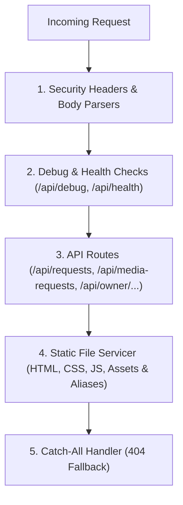

# 📘 Hostinger Project Knowledge Base

**Project:** PMI Pearl City Chapter (PMIPCC) - Portfolio Content Request & Media Hosting Management System  
**Architecture:** Monolithic (Vanilla HTML5/CSS3/JS + Node.js/Express.js + Native SQLite WAL)  
**Deployment Target:** Hostinger VPS (Node.js 22+ / Ubuntu / Debian with PM2 & Nginx) or Hostinger Cloud / hPanel Node.js Application Panel  

---

## 🧠 Core Architecture Explained

We use a **Monolithic** approach instead of separating Frontend and Backend into disjointed microservices or separate domain tiers.

*   **Why?**
    *   **Zero CORS Headaches:** Both frontend pages (`index.html`, `owner.html`, `media-request.html`) and backend APIs (`/api/...`) share the identical origin.
    *   **Unified Session Security:** Secure, `HttpOnly`, `SameSite=Strict` cookies and CSRF tokens are handled natively without third-party token hops.
    *   **Cost & Resource Efficiency:** 1 single Node.js service = 1 low-cost VPS instance. The entire server operates comfortably within **< 80 MB of RAM**, making it ultra-responsive on Hostinger's standard VPS plans.
    *   **Zero Build Step Fragility:** Uses high-performance native HTML5/CSS3/ES6. No multi-gigabyte `node_modules` bundler or `npm run build` failure risks on the remote server.
*   **How?** The Node.js Express server ([`server.js`](file:///c:/Users/Sanjay/OneDrive/Desktop/PMIPCC/final%20-%20Copy%20(2)/server.js)) acts as the **"Traffic Controller"**.

---

### The Traffic Controller Logic (`server.js`)

Requests flow through the server in **Strict Hierarchical Order**:



1.  **Debug / Health Checks:** `/api/debug` & `/api/health`
    *   Defined **FIRST**, guaranteeing uptime probes, Hostinger health monitors, and monitoring bots never fail even under high load.
    *   Returns complete system vitality: Node version, uptime, SQLite WAL connection status, and aggregate statistics (`distinctUsers`, `totalVisitors`).
2.  **API Routes:** `/api/validate-video-link`, `/api/requests`, `/api/media-requests`, `/api/owner/...`
    *   Must be declared **BEFORE** static file handling.
    *   Handles content requisitions, media creation requests, hosting specifications, owner authentication, session checks, and security IP audit logs.
3.  **Static Files & Route Aliases:**
    *   Serves frontend assets directly with mime-type detection and caching rules.
    *   Provides clean URL aliases:
        *   `/` or `/index` $\rightarrow$ `index.html`
        *   `/owner` $\rightarrow$ `owner.html`
        *   `/media-request` $\rightarrow$ `media-request.html`
    *   **Defense-in-Depth Shield:** Prevents direct access to `.env`, `package.json`, `database.sqlite`, `database.js`, or the `uploads/` folder.
4.  **Catch-All & 404 Handler:**
    *   Captures non-existent routes and serves a clean, branded PMIPCC 404 page with a one-click return link.

> [!IMPORTANT]
> **CRITICAL RULE:** API routes must *always* be defined before the Static/Catch-All handler. If routes are moved below the static file middleware, API calls will fall through and trigger a 404 error.

---

## 🛠️ Infrastructure & Packages

### Required Server Packages
*   [`express`](https://expressjs.com/): Web server framework and routing pipeline.
*   [`dotenv`](https://github.com/motdotla/dotenv): Loads environment variables from `.env` on Hostinger or local environments.
*   `node:sqlite` (`DatabaseSync`): Native Node.js 22+ SQLite engine with Write-Ahead Logging (WAL). Eliminates native compilation (`node-gyp` / `python` / `gcc`) errors during Hostinger deployments.
*   `node:crypto`: Provides salted `scrypt` password hashing and collision-checked cryptographic reference IDs.
*   `node:fs` & `node:path`: Standard file system and OS-independent path normalizers (Windows $\leftrightarrow$ Linux).

### Frontend-Backend Bridge
How does the Frontend communicate with the Backend?
*   **Production & Hostinger VPS:** All client scripts ([`js/app.js`](file:///c:/Users/Sanjay/OneDrive/Desktop/PMIPCC/final%20-%20Copy%20(2)/js/app.js), [`js/owner.js`](file:///c:/Users/Sanjay/OneDrive/Desktop/PMIPCC/final%20-%20Copy%20(2)/js/owner.js), [`js/media-request.js`](file:///c:/Users/Sanjay/OneDrive/Desktop/PMIPCC/final%20-%20Copy%20(2)/js/media-request.js)) invoke standard relative paths (`/api/...`). Since frontend and backend run on the identical domain and port, zero URL hardcoding or domain configuration is required.
*   **Local Development:** Works out-of-the-box on `http://localhost:3000` with built-in CORS middleware accepting local or forwarded client headers.

---

## 🚀 Deployment Instructions

### 1. The Environment (`.env`)
Create a `.env` file in the **root** folder of your project on Hostinger:

```ini
# ==============================================================================
# PMI Portfolio Content Request Management System
# Hostinger VPS & Production Environment Configuration
# ==============================================================================

# Server Network Configuration
PORT=3000
HOST=0.0.0.0
NODE_ENV=production

# Owner Bootstrap Authentication (Used for initial login)
INITIAL_OWNER_PASSWORD=owner@pmi2026
INITIAL_OWNER_USERNAME=admin

# Session & Security
# Generate a cryptographically secure random string (32+ chars)
SESSION_SECRET=c8e71b56a42f89d345e098a12f9b4c6e7890123456789abcdef0123456789abc
COOKIE_SECURE=false                  # Set to true once SSL (HTTPS) is activated

# File Storage Configuration
UPLOAD_DIR=./uploads
MAX_FILE_SIZE_MB=15
MAX_TOTAL_UPLOAD_SIZE_MB=25

# Database Configuration (Native SQLite with WAL Mode)
DATABASE_PATH=./database.sqlite

# CORS Configuration
CORS_ORIGIN=*
```

---

### 2. File Preparation & Upload Workflow

Because this system uses native web technologies, **no heavy bundler build step is needed**.

#### What to Upload to Hostinger:
*   Frontend files: `index.html`, `owner.html`, `media-request.html`
*   Stylesheets: `css/` directory and `styles.css`
*   Client Scripts: `js/` directory, `app.js`, `owner.js`, `media-request.js`
*   Assets: `assets/` directory (logos, SVGs, favicon)
*   Backend: `server.js` and `database.js`
*   Configuration: `package.json`, `package-lock.json`, and `.env`

#### What NOT to Upload:
*   ❌ `node_modules/` (Always install dependencies fresh on Hostinger using `npm install`).
*   ❌ `.git/` folder.
*   ❌ Temporary testing artifacts or backup databases.

---

### 3. Hostinger Deployment Options

#### Option A: Hostinger VPS (Recommended - Ubuntu 22.04 / 24.04 with PM2 & Nginx)

1.  **Install Node.js 22 (Required for native `node:sqlite`):**
    ```bash
    curl -fsSL https://deb.nodesource.com/setup_22.x | sudo -E bash -
    sudo apt-get install -y nodejs
    node -v   # Must report v22.x.x or higher
    ```

2.  **Upload Files & Set Permissions:**
    ```bash
    # In your application directory (e.g., /var/www/pmipcc)
    npm install --omit=dev
    mkdir -p uploads
    chmod 755 uploads
    ```

3.  **Start the Application with PM2 (Process Manager):**
    ```bash
    sudo npm install -g pm2
    pm2 start server.js --name "pmipcc-system"
    pm2 save
    pm2 startup
    ```

4.  **Configure Nginx as Reverse Proxy:**
    Edit `/etc/nginx/sites-available/pmipcc`:
    ```nginx
    server {
        server_name yourdomain.com www.yourdomain.com;

        # Enforce maximum body size for file attachments (35MB)
        client_max_body_size 35M;

        location / {
            proxy_pass http://127.0.0.1:3000;
            proxy_http_version 1.1;
            proxy_set_header Upgrade $http_upgrade;
            proxy_set_header Connection 'upgrade';
            proxy_set_header Host $host;
            proxy_set_header X-Real-IP $remote_addr;
            proxy_set_header X-Forwarded-For $proxy_add_x_forwarded_for;
            proxy_set_header X-Forwarded-Proto $scheme;
            proxy_cache_bypass $http_upgrade;
        }
    }
    ```
    Enable and reload:
    ```bash
    sudo ln -s /etc/nginx/sites-available/pmipcc /etc/nginx/sites-enabled/
    sudo nginx -t
    sudo systemctl restart nginx
    ```

5.  **Enable Free SSL with Certbot:**
    ```bash
    sudo apt install -y certbot python3-certbot-nginx
    sudo certbot --nginx -d yourdomain.com -d www.yourdomain.com
    ```
    *(Remember to set `COOKIE_SECURE=true` in `.env` and restart PM2 once HTTPS is active!)*

---

#### Option B: Hostinger Web Hosting Panel (hPanel Node.js Selector)

1.  In **hPanel**, navigate to **Websites** $\rightarrow$ **Node.js**.
2.  Set configuration:
    *   **Node.js Version:** `22.x.x`
    *   **Application Root:** `/` (or subfolder if installed in a subdirectory)
    *   **Application Startup File:** `server.js`
3.  Click **NPM Install** to install dependencies (`express`, `dotenv`).
4.  Click **Restart Application**.

---

## 🐛 Troubleshooting Archive (Known Issues & Fixes)

### 1. "Total Visitors / Stats = 0"
*   **Cause:** Frontend dashboard or external monitoring expected distinct user aggregates, but server sent raw records or 0 on empty tables.
*   **Fix:** [`/api/debug`](file:///c:/Users/Sanjay/OneDrive/Desktop/PMIPCC/final%20-%20Copy%20(2)/server.js#L465) executes high-performance SQL aggregate queries:
    ```sql
    SELECT COUNT(DISTINCT email) FROM (
      SELECT submitter_email FROM content_requests WHERE submitter_email != ''
      UNION
      SELECT submitter_email FROM media_requests WHERE submitter_email != ''
    );
    ```
    Both `distinctUsers` and `totalVisitors` are returned explicitly.

### 2. "API Endpoint Not Found" (404)
*   **Cause:** Static file serving or catch-all wildcard (`*`) was placed above API declarations.
*   **Fix:** In [`server.js`](file:///c:/Users/Sanjay/OneDrive/Desktop/PMIPCC/final%20-%20Copy%20(2)/server.js#L460), all `/api/...` routes are strictly mounted before the static file handler.

### 3. "Blank Page" or Route Not Found on Load
*   **Cause:** Navigating to clean URLs like `/owner` or `/media-request` failed because `.html` was missing from the URL.
*   **Fix:** Built-in route aliasing in [`server.js`](file:///c:/Users/Sanjay/OneDrive/Desktop/PMIPCC/final%20-%20Copy%20(2)/server.js#L2062) automatically maps `/owner` $\rightarrow$ `owner.html` and `/media-request` $\rightarrow$ `media-request.html`.

### 4. "Mobile Layout Broken / Buttons Cut Off"
*   **Cause:** Desktop-first horizontal header layouts overflow on mobile viewports (360px–480px).
*   **Fix:**
    *   `.header-container` stacks vertically on mobile (`flex-direction: column`).
    *   `.header-actions` displays in a responsive 2-column flex grid (`flex: 1 1 calc(50% - 0.45rem)`), ensuring `Change Password` and `Log Out` are completely visible and never cut off.
    *   Inspection modals use flex `min-height: 0` and dynamic viewport height (`max-height: 94dvh`) so bottom buttons and hosting specifications remain reachable.

### 5. "Uploads Failing / EACCES Permission Denied"
*   **Cause:** The Linux user running Node.js cannot write to `uploads/`.
*   **Fix:** Run `chmod 755 uploads` and verify directory ownership (`chown -R www-data:www-data uploads` or your Hostinger VPS user).

### 6. "Port Already in Use" (EADDRINUSE: 3000)
*   **Cause:** A zombie Node.js process is holding port 3000.
*   **Fix:** Find and terminate the process:
    ```bash
    sudo lsof -i :3000
    # or kill directly:
    sudo fuser -k 3000/tcp
    ```

### 7. "Node Version Error: Cannot find module 'node:sqlite'"
*   **Cause:** Running an older Node.js version (< 22.0.0).
*   **Fix:** Upgrade Node.js via NVM (`nvm install 22 && nvm use 22`).

---

## 🔒 Security Notes

*   **Environment Secrets:** Never commit `.env` to Git. The `.gitignore` file is pre-configured to exclude `.env` and `database.sqlite*`.
*   **Owner Authentication:** Owner passwords use salted cryptographic `scrypt` hashing with constant-time verification.
*   **Brute-Force Shield:** Automatic IP rate-limiting locks repeated invalid login attempts for 15 minutes.
*   **File Upload Hardening:**
    *   Files are checked via **magic-byte inspection** (JPEG, PNG, WebP, PDF). Executable extensions (`.exe`, `.sh`, `.php`, `.js`) are strictly rejected.
    *   The `uploads/` directory is never served directly as a public static folder; files are streamed exclusively through the authenticated `/api/owner/attachments/:id` endpoint.
*   **Client IP Security Tracking:** Every form submission and media request records the submitter's verified IP address (`req.headers['x-forwarded-for']` / `cf-connecting-ip`), visible in the Owner Portal Security Audit modal and exportable to CSV.

